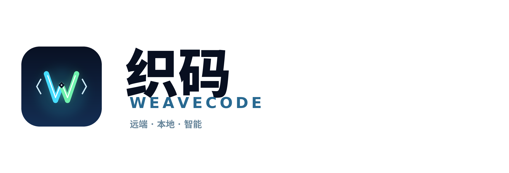

#织码 WeaveCode

<p align="left">
  
</p>

**织码 WeaveCode** = 把远端、源码、通用语言服务和 AI 补全织在一起。

织码 WeaveCode 是一个面向嵌入式 ARM 板卡的远程 IDE。它不是重新画一个编辑器壳，而是以
**CodeOSS 为界面和工作台底座**，用我们自己的 SSH/SFTP 层替换 VS Code Remote-SSH，并让
开发机标准 LSP 通过只读 SSHFS 直接读取远端工作区。

目标机保持轻量：远端只用原生 `sshd` / `sftp` / `git`，**不需要安装 clangd、pylsp、gopls 或
任何语言服务器**。代码智能模式在开发机运行语言库，通过只读 SSHFS 按需读取远端源码、系统头
和 ROS 环境；不复制源码/sysroot，不常驻 VS Code Server。浏览模式不启动语言服务。

## 目录结构

```text
.
├── ide/
│   ├── vscode/                 # 上游 CodeOSS 子模块（固定提交，不提交构建产物）
│   ├── extensions/sshfs/       # 我们唯一的 CodeOSS 扩展真源
│   │   ├── package.json        # 命令、菜单、配置、终端 profile、proposed API
│   │   └── src/
│   │       ├── extension.js    # 扩展入口 / 连接管理 / 状态和命令
│   │       ├── session.js      # SSH 会话（凭据只存内存）
│   │       ├── fs-provider.js  # sshfs:// 文件系统
│   │       ├── terminal.js     # 远端终端
│   │       ├── search.js       # 远端搜索
│   │       ├── scm.js          # 远端 Git / Source Control
│   │       ├── lsp.js          # 标准 LSP 桥 + 双模式 + URI/path 映射
│   │       ├── cache.js        # 影子缓存 LRU/TTL/容量管理
│   │       └── tasks.js        # 远端任务
│   └── tools/                  # 构建、启动、端到端、VSIX 安装
├── src/
│   ├── main/                   # 共享核心：SSH/SFTP/Git/搜索/终端/镜像/LSP
│   └── shared/                 # 跨模块类型和纯函数
├── tests/                      # 核心单元 / 集成测试
├── docs/
│   ├── ssh-vs-remotessh.md     # 与 VS Code Remote-SSH 的差异和实现边界
│   ├── lsp-mirror-design.md    # 远端标准 LSP / 双模式 / 兼容镜像设计
│   └── legacy/                 # 已停止维护的 V2 自绘 UI 规格
└── resources/                  # 图标、语言服务资源说明
```

旧 V2（Electron + Monaco 自绘外壳）已经从主线删除。保留的 `src/` 只是 CodeOSS 扩展复用的
SSH/SFTP/Git/搜索/终端/镜像/LSP 核心，不再是独立应用程序。

## 品牌资产

品牌名为 **织码 WeaveCode**，视觉资产在 `resources/brand/`：

- `weavecode-mark.svg`：主标记
- `weavecode-lockup-light.svg` / `weavecode-lockup-dark.svg`：明暗字标
- `weavecode-icon-1024.png`、`weavecode.icns`、`resources/icon.ico`：应用图标
- `ide/tools/generate-brand-assets.py`：可重复生成全部资产

`apply-branding.mjs` 会在构建时把这些图标同步到 CodeOSS 的 Linux / Windows / macOS / Server 图标路径。

## 快速开始

要求：Linux 开发机、Node.js 24（与 `ide/vscode/.nvmrc` 对齐）、`git`、`npm`。

```bash
# 1. 拉取固定版本的 CodeOSS 子模块
npm run codeoss:bootstrap

# 2. 安装本仓库核心依赖
npm install

# 3. 给上游 CodeOSS 打品牌补丁（幂等）
node ide/tools/apply-branding.mjs

# 4. 编译共享核心
npm run compile

# 5. 第一次还需要在上游目录安装依赖并构建 CodeOSS
cd ide/vscode
npm_config_userconfig=../tools/empty-npmrc npm install --no-audit --no-fund
npm run compile
npm run electron
npm run gulp vscode-linux-x64
cd ../..

# 6. 打包并同步我们的内置扩展
npm run build:extension

# 7. 构建可安装的 Linux amd64 deb
npm run build:deb
```

deb 产物在 `ide/dist/weavecode_<version>_amd64.deb`，同时生成 `.sha256`、包元数据和内容清单。
构建需要系统的 `dpkg-deb` 与 `fakeroot`；默认会自动复用本机 Electron 缓存。发布前可执行完整门禁：

```bash
npm run verify:release
```

安装：

```bash
sudo apt install ./ide/dist/weavecode_<version>_amd64.deb
```

默认 deb 使用 **Open VSX**，适合开源分发。仅限个人自用、且你接受 Microsoft Marketplace
服务条款的本地构建，可以显式切换市场：

```bash
RCE_EXTENSION_GALLERY=microsoft npm run build:deb
```

该模式产物文件名会带 `-ms-marketplace`。不要把这个个人构建当作公开分发版本；企业/私有插件源
可以通过 `RCE_EXTENSION_GALLERY_JSON='{"serviceUrl":"..."}'` 注入。

## 运行

```bash
# 假靶机：直接打开一个可点击的文件/终端/SCM 示例
npm run run

# 真板子
bash ide/tools/run-app.sh user@192.168.1.50:22 /home/root/app
```

密码只通过环境变量 `RCE_PASS` 传入，或者由窗口中的连接表单临时输入；不会写入
`hosts.json`、日志或崩溃转储。

## 语言服务

语言服务默认 `mount`，通用标准 LSP 在开发机运行：

```text
sshfs://user@host:port/项目/src/main.c
        ⇅ 只读 SSHFS 惰性文件视图
开发机 clangd / 内置 pylsp / gopls / rust-analyzer / 任意标准 LSP
```

- 目标机不需要安装任何语言服务；只需要 sshd/sftp；
- 开发机用只读 SSHFS 直接读取远端整棵文件系统，源码、`/usr/include`、ROS SDK 都按需访问，不复制；
- 远端 `compile_commands.json` 和 CMake flags 会重写到 SSHFS 挂载前缀，目标架构仍由远端 GCC 探测；
- C++/ROS 内置开发机 clangd；Python 内置 `python-lsp-server`，不依赖开发机预装；
- 任意语言都可用 `rce.lsp.servers` 配置，例如
  `{"go":{"command":"gopls","args":[],"extensions":[".go"],"rootMarkers":["go.mod"]}}`；
- 浏览模式不启动 LSP；切换到代码智能时当前文件优先启动，不重启窗口，标签、光标和撤销历史保留；
- 浏览模式下第一次编辑会自动进入代码智能，服务器就绪后自动触发补全；输入 `in` 等前缀会出现标准
  LSP 补全框，不依赖 AI；
- 切回浏览模式先热保留 5 分钟（可配置），期间切回无冷启动顿挫，超时后进程退出；
- 支持补全、诊断、跳转、声明/类型定义/实现、引用、重命名、悬浮、符号、签名帮助、代码操作、
  格式化和折叠；过期请求通过 `$/cancelRequest` 取消，连续输入只同步最新全文。

开发机需要安装 `sshfs`（deb 会自动作为依赖安装）。`remote` 模式仅供目标机本来就有 LSP 的场景，
`local` 是旧镜像兼容模式，两者都不再默认使用。

## GitHub Copilot

本仓库不内置 GitHub Copilot 的专有二进制/VSIX。你可以在自己的机器上使用官方 VSIX：

```bash
# 把 VS Code 里的 GitHub Copilot VSIX 安装到开发版扩展目录
bash ide/tools/install-vsix.sh /path/to/GitHub.copilot.vsix

# 然后重启织码 WeaveCode，在编辑器里登录 GitHub Copilot
```

说明：

- Copilot 是独立扩展，和本机 clangd 互不替代；
- 我们只负责让 CodeOSS 工作区和文件系统对它可用，不保存你的 Copilot 凭据；
- 是否允许把代码发送给 Copilot 由你的账号和策略决定；
- 如果使用 VS Code 官方安装目录，VSIX 通常可以在其扩展缓存中找到，或者从扩展市场手动下载。

## 校验

```bash
npm run lint
npm run typecheck
npm test
bash ide/tools/run-e2e.sh
```

`run-e2e.sh` 需要 X / xvfb 和本地监听端口，会在 CodeOSS 里打开 `sshfs://` 工作区，
验证文件、终端、搜索、SCM、远端配置、任务和本机 LSP + 只读 SSHFS 链路，并输出 JSON 报告与截图。
